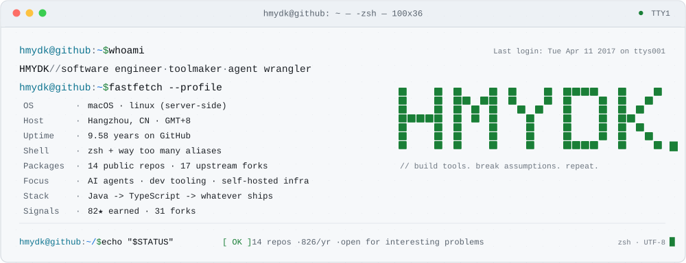
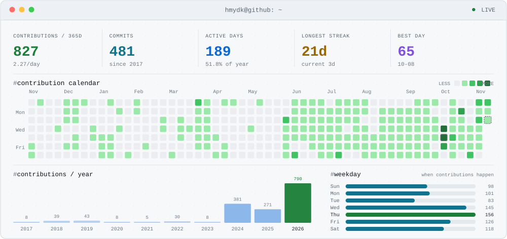
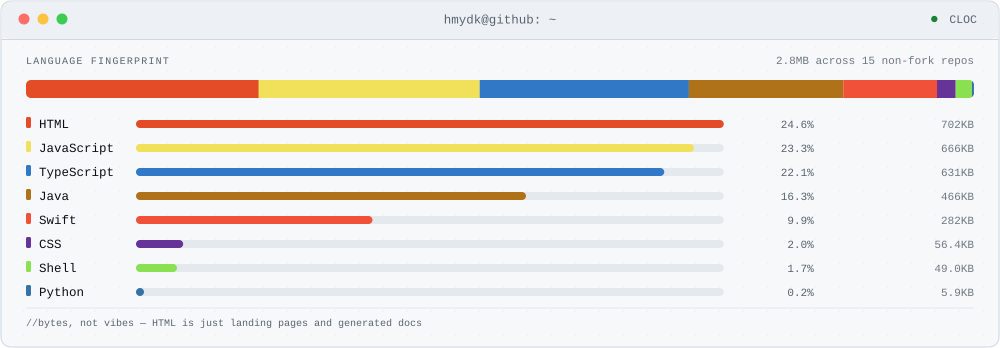

<!--
  this README is a compiled artifact — edit scripts/render.mjs, not this file.
  data: data/profile.json · build: .github/workflows/profile.yml (daily)
-->

<a href="https://raw.githubusercontent.com/HMYDK/HMYDK/main/assets/hero-light.svg?v=25deb0d34b" title="open the full-size card">
<picture>
  <source media="(prefers-color-scheme: dark)" srcset="https://raw.githubusercontent.com/HMYDK/HMYDK/main/assets/hero-dark.svg?v=25deb0d34b">
  <source media="(prefers-color-scheme: light)" srcset="https://raw.githubusercontent.com/HMYDK/HMYDK/main/assets/hero-light.svg?v=25deb0d34b">
  
</picture>
</a>

### `$ cat ~/.now`

> Currently building agent infrastructure on [DeepSeek Harness](https://github.com/HMYDK/ai-native-sdlc-dsh) —
> making the agent-native software loop boring and verifiable.
> Previously: JetBrains plugins, macOS tooling, backend platforms.
> Optimizing for: ship small, own the stack, read the source.

### `$ ls ~/projects`

<!-- AUTOGEN:projects -->
| repo | what it is |
|:--|:--|
| [`AIGitCommit`](https://github.com/HMYDK/AIGitCommit)   Java · pushed 2026-08 | **82★** · 30 forks — JetBrains plugin that writes your commit messages from the diff. The one people actually use. |
| [`ai-native-sdlc-dsh`](https://github.com/HMYDK/ai-native-sdlc-dsh)   TypeScript · pushed 2026-11 | AI-native SDLC as a DeepSeek Harness plugin: task state machine, artifact chain, independent verification |
| [`mcp-manager`](https://github.com/HMYDK/mcp-manager)   Swift · pushed 2026-03 | SwiftUI control panel for MCP servers |
| [`AICodeToolSet`](https://github.com/HMYDK/AICodeToolSet)   Java · pushed 2024-08 | A toolbox of AI code utilities for JetBrains IDEs |
| [`switch-your-fucking-language-version`](https://github.com/HMYDK/switch-your-fucking-language-version)   Swift · pushed 2026-02 | Native SwiftUI app to switch Java / Node / Python / Go versions on macOS |
| [`code-on-phone`](https://github.com/HMYDK/code-on-phone)   Shell · pushed 2026-02 | Coding from a phone, because laptops are heavy |
<!-- /AUTOGEN:projects -->

### `$ fastfetch --live`

<a href="https://raw.githubusercontent.com/HMYDK/HMYDK/main/assets/telemetry-light.svg?v=25deb0d34b" title="open the full-size card">
<picture>
  <source media="(prefers-color-scheme: dark)" srcset="https://raw.githubusercontent.com/HMYDK/HMYDK/main/assets/telemetry-dark.svg?v=25deb0d34b">
  <source media="(prefers-color-scheme: light)" srcset="https://raw.githubusercontent.com/HMYDK/HMYDK/main/assets/telemetry-light.svg?v=25deb0d34b">
  
</picture>
</a>

### `$ cloc .`

<a href="https://raw.githubusercontent.com/HMYDK/HMYDK/main/assets/languages-light.svg?v=25deb0d34b" title="open the full-size card">
<picture>
  <source media="(prefers-color-scheme: dark)" srcset="https://raw.githubusercontent.com/HMYDK/HMYDK/main/assets/languages-dark.svg?v=25deb0d34b">
  <source media="(prefers-color-scheme: light)" srcset="https://raw.githubusercontent.com/HMYDK/HMYDK/main/assets/languages-light.svg?v=25deb0d34b">
  
</picture>
</a>

### `$ tail -f ~/.git/activity.log`

<!-- AUTOGEN:timeline -->
<pre>
# recent public activity · UTC
2026-11-10 02:53  <a href="https://github.com/wechaty/wechaty">starred wechaty/wechaty</a>
2026-11-09 09:53  <a href="https://github.com/HMYDK/OpenViking/compare/c66884cd33...fc79d7acbb">pushed OpenViking</a>
2026-11-09 08:41  <a href="https://github.com/volcengine/OpenViking/issues/5894#issuecomment-6735809599">commented on an issue in OpenViking</a>
2026-11-09 08:41  <a href="https://github.com/HMYDK/OpenViking/compare/579d012c35...c66884cd33">pushed OpenViking</a>
2026-11-09 08:26  <a href="https://github.com/volcengine/OpenViking/pull/7266">opened a pull request in OpenViking</a>
2026-11-09 08:12  <a href="https://github.com/volcengine/OpenViking/issues/5894#issuecomment-6735324883">commented on an issue in OpenViking</a>
</pre>
<!-- /AUTOGEN:timeline -->

<code>$ cat .github/workflows/profile.yml</code> — how this page is built

Every stat above comes from GitHub's GraphQL API and public Atom feed, is archived in
[`data/profile.json`](https://github.com/HMYDK/HMYDK/blob/main/data/profile.json), and is compiled
into hand-written SVG by [`scripts/render.mjs`](https://github.com/HMYDK/HMYDK/blob/main/scripts/render.mjs).
No third-party stat cards, no trackers — rebuilt daily by GitHub Actions.

---

  
    compiled 2026-11-10 ·
    <a href="https://github.com/HMYDK/HMYDK">source</a> ·
    open an issue on any repo if you want to talk
  

