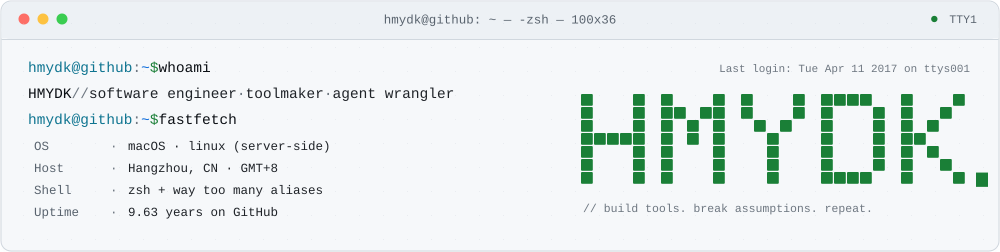
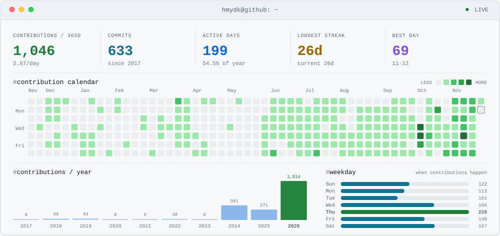
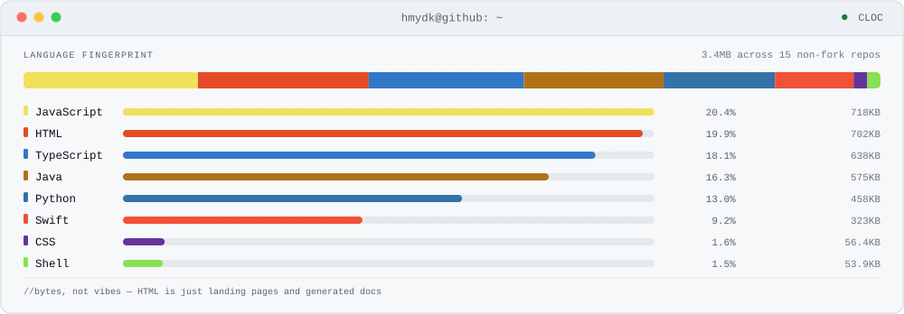

<!--
  this README is a compiled artifact — edit scripts/render.mjs, not this file.
  data: data/profile.json · build: .github/workflows/profile.yml (daily)
-->

<a href="https://raw.githubusercontent.com/HMYDK/HMYDK/main/assets/hero-light.svg?v=6d0d582126" title="open the full-size card">
<picture>
  <source media="(prefers-color-scheme: dark)" srcset="https://raw.githubusercontent.com/HMYDK/HMYDK/main/assets/hero-dark.svg?v=6d0d582126">
  <source media="(prefers-color-scheme: light)" srcset="https://raw.githubusercontent.com/HMYDK/HMYDK/main/assets/hero-light.svg?v=6d0d582126">
  
</picture>
</a>

### `$ cat ~/.now`

> Currently building agent infrastructure on [DeepSeek Harness](https://github.com/HMYDK/ai-native-sdlc-dsh) —
> making the agent-native software loop boring and verifiable.
> Previously: JetBrains plugins, macOS tooling, backend platforms.
> Optimizing for: ship small, own the stack, read the source.

### `$ ls ~/projects --starred`

<!-- AUTOGEN:projects -->
- [`AIGitCommit`](https://github.com/HMYDK/AIGitCommit) — **82★** · 30 forks · Java · pushed 2026-11 — JetBrains plugin that writes your commit messages from the diff. The one people actually use.
<!-- /AUTOGEN:projects -->

### `$ fastfetch --live`

<a href="https://raw.githubusercontent.com/HMYDK/HMYDK/main/assets/telemetry-light.svg?v=6d0d582126" title="open the full-size card">
<picture>
  <source media="(prefers-color-scheme: dark)" srcset="https://raw.githubusercontent.com/HMYDK/HMYDK/main/assets/telemetry-dark.svg?v=6d0d582126">
  <source media="(prefers-color-scheme: light)" srcset="https://raw.githubusercontent.com/HMYDK/HMYDK/main/assets/telemetry-light.svg?v=6d0d582126">
  
</picture>
</a>

### `$ cloc .`

<a href="https://raw.githubusercontent.com/HMYDK/HMYDK/main/assets/languages-light.svg?v=6d0d582126" title="open the full-size card">
<picture>
  <source media="(prefers-color-scheme: dark)" srcset="https://raw.githubusercontent.com/HMYDK/HMYDK/main/assets/languages-dark.svg?v=6d0d582126">
  <source media="(prefers-color-scheme: light)" srcset="https://raw.githubusercontent.com/HMYDK/HMYDK/main/assets/languages-light.svg?v=6d0d582126">
  
</picture>
</a>

### `$ tail -f ~/.git/activity.log`

<!-- AUTOGEN:timeline -->
<pre>
# recent public activity · UTC
2026-11-16 11:02  <a href="https://github.com/HMYDK/ai-native-sdlc-dsh/issues/22#issuecomment-6914591158">commented on an issue in ai-native-sdlc-dsh</a>
2026-11-16 07:35  <a href="https://github.com/HMYDK/ai-native-sdlc-dsh/issues/22#issuecomment-6910345880">commented on an issue in ai-native-sdlc-dsh</a>
2026-11-16 07:30  <a href="https://github.com/HMYDK/ai-native-sdlc-dsh/issues/22#issuecomment-6910257496">commented on an issue in ai-native-sdlc-dsh</a>
2026-11-16 07:25  <a href="https://github.com/HMYDK/ai-native-sdlc-dsh/issues/22#issuecomment-6910175225">commented on an issue in ai-native-sdlc-dsh</a>
2026-11-16 07:13  <a href="https://github.com/HMYDK/ai-native-sdlc-dsh/issues/22#issuecomment-6909962677">commented on an issue in ai-native-sdlc-dsh</a>
2026-11-16 05:38  <a href="https://github.com/HMYDK/ai-native-sdlc-dsh/issues/22#issuecomment-6908357990">commented on an issue in ai-native-sdlc-dsh</a>
</pre>
<!-- /AUTOGEN:timeline -->

<code>$ cat .github/workflows/profile.yml</code> — how this page is built

Every stat above comes from GitHub's GraphQL API and public Atom feed, is archived in
[`data/profile.json`](https://github.com/HMYDK/HMYDK/blob/main/data/profile.json), and is compiled
into hand-written SVG by [`scripts/render.mjs`](https://github.com/HMYDK/HMYDK/blob/main/scripts/render.mjs).
No third-party stat cards, no trackers — rebuilt daily by GitHub Actions.

---

  
    compiled 2026-11-16 ·
    <a href="https://github.com/HMYDK/HMYDK">source</a> ·
    open an issue on any repo if you want to talk
  

