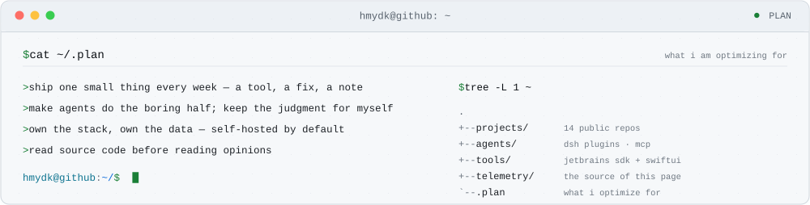

<!--
  ┌──────────────────────────────────────────────────────────────────────┐
  │  this README is a compiled artifact. do not edit by hand.            │
  │  source : scripts/render.mjs        data : data/profile.json         │
  │  build  : .github/workflows/profile.yml (daily, 03:17 UTC)           │
  │  last   : 2026-11-10  ·  14 repos · 82★ · 826 contributions/365d
  └──────────────────────────────────────────────────────────────────────┘
-->

<p align="center">
<a href="https://raw.githubusercontent.com/HMYDK/HMYDK/main/assets/hero-light.svg?v=472ca6ee2f" title="open the full-size card">
<picture>
  <source media="(prefers-color-scheme: dark)" srcset="https://raw.githubusercontent.com/HMYDK/HMYDK/main/assets/hero-dark.svg?v=472ca6ee2f">
  <source media="(prefers-color-scheme: light)" srcset="https://raw.githubusercontent.com/HMYDK/HMYDK/main/assets/hero-light.svg?v=472ca6ee2f">
  
</picture>
</a>
</p>

### `$ whoami`

> Backend engineer by day, **product maker by night**.
> I turn repetitive work into tools, and tools into agents that ship while I sleep.
> Currently: teaching [DeepSeek Harness](https://github.com/HMYDK/ai-native-sdlc-dsh) new tricks —
> task state machines, artifact chains, independent verification.
> Hangzhou · GMT+8 · `9.58` years on GitHub · 14 non-fork repos.

### `$ ls ~/projects --sort=stars`

<!-- AUTOGEN:projects -->
| repo | what it is | ★ |
|:--|:--|--:|
| [`AIGitCommit`](https://github.com/HMYDK/AIGitCommit) <br> <sub>Java · pushed 2026-08</sub> | JetBrains plugin that writes your commit messages from the diff — the one people actually use | **82** |
| [`ai-native-sdlc-dsh`](https://github.com/HMYDK/ai-native-sdlc-dsh) <br> <sub>TypeScript · pushed 2026-11</sub> | AI-native SDLC as a DeepSeek Harness plugin: task state machine, artifact chain, independent verification | — |
| [`mcp-manager`](https://github.com/HMYDK/mcp-manager) <br> <sub>Swift · pushed 2026-03</sub> | SwiftUI control panel for MCP servers | — |
| [`AICodeToolSet`](https://github.com/HMYDK/AICodeToolSet) <br> <sub>Java · pushed 2024-08</sub> | A toolbox of AI code utilities for JetBrains IDEs | — |
| [`switch-your-fucking-language-version`](https://github.com/HMYDK/switch-your-fucking-language-version) <br> <sub>Swift · pushed 2026-02</sub> | Native SwiftUI app to switch Java / Node / Python / Go versions on macOS | — |
| [`code-on-phone`](https://github.com/HMYDK/code-on-phone) <br> <sub>Shell · pushed 2026-02</sub> | Coding from a phone, because laptops are heavy | — |
<!-- /AUTOGEN:projects -->

### `$ fastfetch --live`

<p align="center">
<a href="https://raw.githubusercontent.com/HMYDK/HMYDK/main/assets/telemetry-light.svg?v=472ca6ee2f" title="open the full-size card">
<picture>
  <source media="(prefers-color-scheme: dark)" srcset="https://raw.githubusercontent.com/HMYDK/HMYDK/main/assets/telemetry-dark.svg?v=472ca6ee2f">
  <source media="(prefers-color-scheme: light)" srcset="https://raw.githubusercontent.com/HMYDK/HMYDK/main/assets/telemetry-light.svg?v=472ca6ee2f">
  
</picture>
</a>
</p>

### `$ cloc .`

<p align="center">
<a href="https://raw.githubusercontent.com/HMYDK/HMYDK/main/assets/languages-light.svg?v=472ca6ee2f" title="open the full-size card">
<picture>
  <source media="(prefers-color-scheme: dark)" srcset="https://raw.githubusercontent.com/HMYDK/HMYDK/main/assets/languages-dark.svg?v=472ca6ee2f">
  <source media="(prefers-color-scheme: light)" srcset="https://raw.githubusercontent.com/HMYDK/HMYDK/main/assets/languages-light.svg?v=472ca6ee2f">
  
</picture>
</a>
</p>

### `$ cat ~/stack.txt`

```console
lang   Java · TypeScript · Swift · JavaScript · Python · Shell
ai     deepseek harness · dsh plugins · mcp · llm agents · rag · prompt-as-code
craft  jetbrains sdk · swiftui · react/next.js · vite · tailwind · chrome extensions
infra  docker · linux · github actions · spring cloud · nacos · sentinel
method test-first · verify-always · ship-small · read-the-source
```

### `$ tail -f ~/.git/activity.log`

<!-- AUTOGEN:timeline -->
<pre>
# live github timeline · times in UTC
2026-11-10 02:53  <a href="https://github.com/wechaty/wechaty">starred wechaty/wechaty</a>
2026-11-09 09:53  <a href="https://github.com/HMYDK/OpenViking/compare/c66884cd33...fc79d7acbb">pushed OpenViking</a>
2026-11-09 08:41  <a href="https://github.com/volcengine/OpenViking/issues/5894#issuecomment-6735809599">commented on an issue in OpenViking</a>
2026-11-09 08:41  <a href="https://github.com/HMYDK/OpenViking/compare/579d012c35...c66884cd33">pushed OpenViking</a>
2026-11-09 08:26  <a href="https://github.com/volcengine/OpenViking/pull/7266">opened a pull request in OpenViking</a>
2026-11-09 08:12  <a href="https://github.com/volcengine/OpenViking/issues/5894#issuecomment-6735324883">commented on an issue in OpenViking</a>
2026-11-08 10:49  <a href="https://github.com/HMYDK/ai-native-sdlc-dsh/issues/12">opened an issue in ai-native-sdlc-dsh</a>
2026-11-08 05:16  <a href="https://github.com/HMYDK/ai-native-sdlc-dsh/compare/90260f341d...8ec09975d3">pushed ai-native-sdlc-dsh</a>
2026-11-08 05:16  <a href="https://github.com/HMYDK/ai-native-sdlc-dsh/pull/11">contributed to HMYDK/ai-native-sdlc-dsh</a>
</pre>
<!-- /AUTOGEN:timeline -->

### `$ cat ~/.plan`

<p align="center">
<a href="https://raw.githubusercontent.com/HMYDK/HMYDK/main/assets/plan-light.svg?v=472ca6ee2f" title="open the full-size card">
<picture>
  <source media="(prefers-color-scheme: dark)" srcset="https://raw.githubusercontent.com/HMYDK/HMYDK/main/assets/plan-dark.svg?v=472ca6ee2f">
  <source media="(prefers-color-scheme: light)" srcset="https://raw.githubusercontent.com/HMYDK/HMYDK/main/assets/plan-light.svg?v=472ca6ee2f">
  
</picture>
</a>
</p>

### `$ ping hmydk`

```console
$ ping hmydk
PING hmydk (github.com/HMYDK): 56 data bytes
64 bytes from HMYDK: seq=0 ttl=64 time=9.58y — online since 2017
64 bytes from HMYDK: seq=1 ttl=64 time=826/yr — still shipping
64 bytes from HMYDK: seq=2 ttl=64 time=82★ — top repo AIGitCommit
--- hmydk ping statistics ---
3 packets transmitted, 3 received, 0% packet loss
```

Open an issue on any repo if you want to talk. Or star **AIGitCommit** if it saved you time.

<details>
<summary><code>$ cat ~/.github/workflows/profile.yml</code> — how this page is built</summary>

Every stat on this page comes from GitHub's GraphQL API, is archived in
[`data/profile.json`](https://github.com/HMYDK/HMYDK/blob/main/data/profile.json), and is compiled into hand-written SVG by
[`scripts/render.mjs`](https://github.com/HMYDK/HMYDK/blob/main/scripts/render.mjs). A GitHub Action re-runs the whole pipeline
daily and commits the diff. No third-party stat cards, no external trackers — the only
service involved is GitHub itself.

```console
$ node scripts/collect.mjs && node scripts/render.mjs
[collect] HMYDK: 14 repos · 82★ · 826 contributions/yr · streak 3 · longest 21
[render]  assets: 8 svg · README.md · build 2026-11-10
```

</details>

---

<p align="center">
  <sub>
    <code>826</code> contributions / 365d ·
    <code>21d</code> longest streak ·
    <code>82★</code> earned ·
    <code>11</code> followers ·
    <code>9.58y</code> uptime ·
    built with <code>node</code> + <code>github actions</code> · 2026-11-10
  </sub>
</p>
